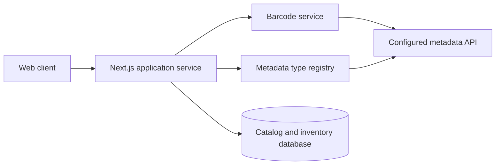
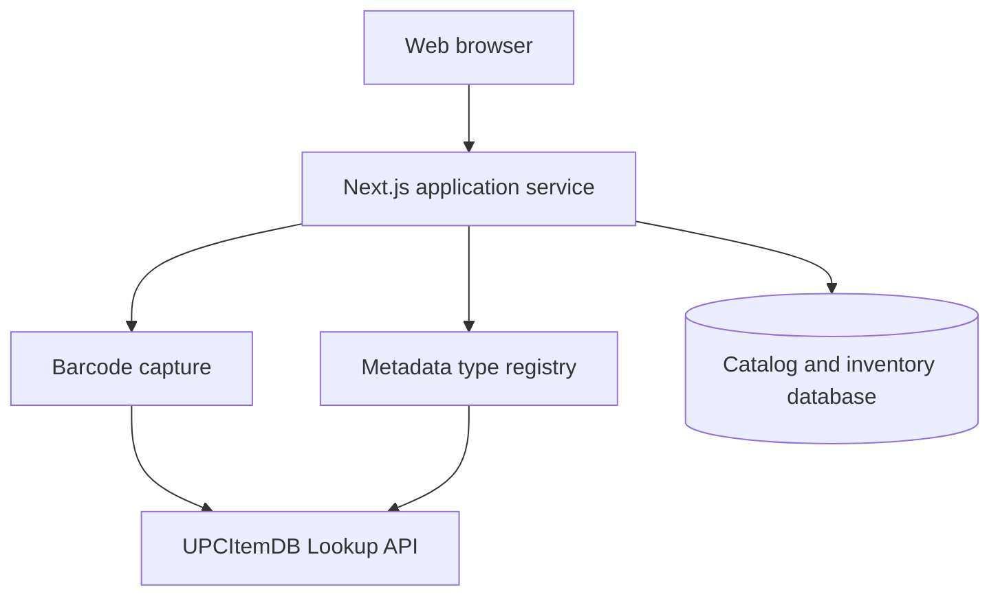
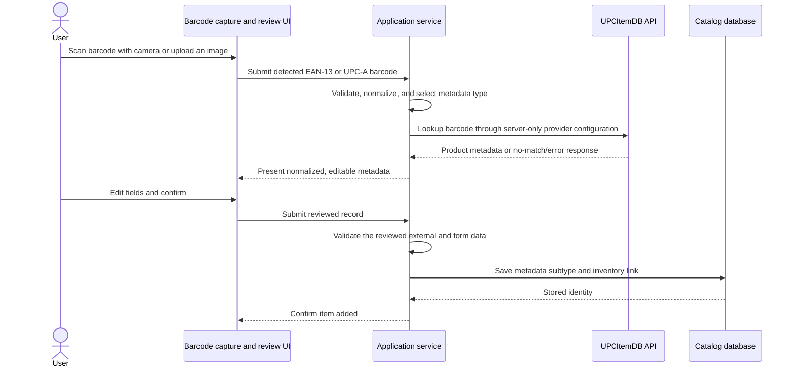

# Architecture

> **Status:** Draft
> **Last updated:** 2026-11-24
> **Owner:** TBD

## 1. Purpose

This project stores and presents information about a personal media collection.

## 2. Application Overview

| Field | Description |
| --- | --- |
| Application name | Personal Media Manager |
| Business purpose | Proof of concept |
| Primary users | Daniel Kehl |
| Lifecycle status | In development |
| Repository | TBD |

### Summary

This project is a learning application built on the Next.js full-stack platform. It uses scannable product identities as an entry point for media metadata and inventory records.

## 3. Goals and Non-Goals

### Goals

- Store and present information about a personal media collection.
- Demonstrate frontend and backend development.
- Demonstrate system design with defined provider, metadata-type, and data-store extension points.
- Start each media-type add flow with an EAN or UPC barcode.
- Let the user review, edit, and confirm provider data before storing a record.

### Non-goals

- This is not a commercial product.
- A provider API is not the authority for manually corrected or edited inventory metadata.
- The initial implementation is not required to support every external metadata provider.

## 4. System Diagram

## 5. Container Architecture

| Container | Responsibility | Technology | Deployment |
| --- | --- | --- | --- |
| Web client | Captures barcodes, presents provider results, and accepts user edits | Next.js, React, TypeScript, html5-qrcode | Web browser |
| Application service | Validates barcode values, invokes providers, renders pages, and stores reviewed records | Next.js server components and route handlers | Local application |
| Barcode service | Reads an EAN or UPC barcode from a camera stream or uploaded file | html5-qrcode | Browser |
| Metadata type registry | Maps metadata types to provider configuration and normalized record schemas | TypeScript configuration | Application service |
| Metadata provider | Retrieves more detailed metadata for a validated barcode | UPCItemDB Lookup API initially | External service |
| Catalog and inventory database | Stores shared identities, type-specific metadata, and inventory links | SQLite | Local application data |

## 6. Components

| Container | Component | Responsibility |
| --- | --- | --- |
| Web client | Barcode capture component | Uses `html5-qrcode` for live camera scanning and image-file barcode decoding |
| Web client | Add-item review form | Displays normalized metadata and permits confirmation or editing |
| Application service | Barcode lookup route | Validates an EAN-13 or UPC-A barcode and invokes the configured provider |
| Application service | Metadata type registry | Maps `upcitem` to UPCItemDB configuration and the UPCItemMetadata schema |
| Application service | Inventory operations | Stores confirmed metadata and inventory links with database referential integrity |
| Catalog database | Catalog metadata tables | Stores generated identities and type-specific metadata |
| UPCItemDB provider | Lookup adapter | Calls the configured UPCItemDB endpoint and normalizes provider results |

## 7. Barcode-First Add-Item Flow

The flow is independent of provider success:

- Camera scanning and file decoding may be used alternately.
- A decoded barcode can be checked manually or entered directly.
- If lookup succeeds, provider fields populate the review form.
- If lookup returns no match, an error, or a rate-limit response, the user can enter metadata manually.
- The record is persisted only after the user confirms or edits the review.

## 8. Data Architecture

### Data stores

| Store | Data held | Owner | Retention / lifecycle |
| --- | --- | --- | --- |
| `catalog.sqlite` | Generated metadata identities, UPCItemMetadata rows, and inventory links | Application service | Persistent local application data |
| UPCItemDB Lookup API | UPC-A/EAN-13 product metadata | UPCItemDB | Retrieved on demand; provider responses are never the only persisted record |
| Optional TMDB API | Movie metadata | TMDB | Retrieved on demand by future configured metadata types |

### Important entities

| Entity | Description | Sensitivity |
| --- | --- | --- |
| Metadata item | Shared generated identity and metadata subtype discriminator | Personal collection data |
| UPCItemMetadata | Barcode-based product metadata for 12-digit UPC-A or 13-digit EAN-13 items | Personal collection data |
| Inventory item | References a metadata identity and subtype through a foreign-key relationship | Personal collection data |
| Barcode capture | Barcode value detected from a live camera stream or uploaded file | User-provided image data |

### Initial metadata type: `upcitem`

`upcitem` is the initial configured metadata type. It accepts:

- UPC-A: 12 digits.
- EAN-13: 13 digits.
- UPC-A values that can be represented with a leading zero for EAN-13 lookup may be preserved without changing the user's reviewed barcode.

The provider adapter must normalize UPCItemDB responses into a stable record shape. Provider fields remain optional until the user reviews and confirms them.

| Server setting | Purpose |
| --- | --- |
| `UPCITEMDB_API_URL` | Provider base URL. It defaults to the UPCItemDB free/trial lookup endpoint. |
| `UPCITEMDB_API_KEY` | Optional credential for a configured UPCItemDB plan. It must remain server-only. |
| `UPCITEMDB_REQUEST_TIMEOUT_MS` | Provider lookup timeout. |

Provider behavior must be bounded: authentication failures, no-match responses, malformed payloads, free-tier limits, and network timeouts must return a recoverable application error. They must not block manual entry or edit.

## 9. Interfaces and Contracts

| Interface | Direction | Contract / format | Authentication |
| --- | --- | --- | --- |
| `/upcitem/add` | Client to application service | Barcode capture, provider review, editing, and confirmed record submission | TBD |
| `/upcitem/lookup/api` | Client to application service | JSON request containing an EAN-13 or UPC-A barcode | Server-side UPCItemDB configuration |
| `/upcitem/view` | Client to application service | HTML collection or detail presentation for UPCItemMetadata | TBD |
| `/inventory/api` | Client to application service | JSON inventory records with resolved metadata subtype | TBD |

### Application route convention

Organize application routes as `/{type}/{action}/{parameters}`. The first segment identifies a configured metadata type, the second identifies the action, and optional trailing segments identify a record or parameter.

Use `api` for JSON data endpoints, `view` for human-facing pages, and `add` for the review-and-confirm creation flow. The initial route set is:

- `/upcitem/add`
- `/upcitem/lookup/api`
- `/upcitem/view`

Future types use the same route convention and may replace the barcode lookup action with another identity-specific action.

## 10. Quality Attributes and Constraints

| Attribute or constraint | Requirement |
| --- | --- |
| Availability | A provider outage must not prevent manual metadata entry |
| Performance | Barcode lookup should have a bounded timeout and responsive browser feedback |
| Scalability | Provider and metadata-type behavior must be isolated behind adapters |
| Accessibility | Camera controls, file upload, form fields, errors, and confirmation actions must be keyboard and screen-reader usable |
| Compatibility | The browser flow must support camera permission denial and uploaded barcode files |
| Security | UPCItemDB and future provider credentials are server-only |

## 11. Security and Privacy

| Concern | Design / policy |
| --- | --- |
| Authentication | TBD |
| Authorization | TBD |
| Secrets management | Store provider credentials in ignored local environment files and server-side configuration |
| Sensitive data handling | Barcode and inventory data remain local; only decoded barcodes are sent to configured providers |
| Audit and logging | Log provider status and errors without provider response values or secrets |
| Threats and mitigations | Validate barcode format and provider/form payloads; enforce request limits and bounded provider timeouts |

## 12. Deployment and Runtime

| Environment | Purpose | Hosting / region | Notes |
| --- | --- | --- | --- |
| Development | Local application development | TBD | Camera scanning may require an allowed browser origin |
| Test / staging | TBD | TBD | Provider tests should use fixtures or a configurable test endpoint |
| Production | TBD | TBD | Provider credentials and SQLite storage require deployment-specific configuration |

## 13. Operations and Observability

| Concern | Approach |
| --- | --- |
| Health checks | Report application and local database status without exposing secrets |
| Metrics | Track lookup success, no-match, timeout, provider-limit, and manual-entry outcomes |
| Logs | Log operation status and normalized error categories, not credentials or sensitive response values |
| Traces | Correlate barcode lookup and record confirmation when a tracing provider is configured |
| Alerting | TBD |
| Backup and recovery | Back up the catalog SQLite database and document restore behavior |
| Incident response | TBD |

## 14. Dependencies

| Dependency | Purpose | Criticality | Owner |
| --- | --- | --- | --- |
| `html5-qrcode` | Camera and uploaded-file barcode capture | Required for the initial add flow | Application |
| UPCItemDB Lookup API | Free/trial provider lookup for UPC-A and EAN-13 barcodes | Optional enrichment; manual entry remains available | External provider |
| SQLite | Local catalog and inventory persistence | Required | Application |
| Zod or project-approved schema validation | Validates provider, form, and database data | Required | Application |

## 15. Architecture Decisions

| Decision | Status | Rationale / ADR |
| --- | --- | --- |
| Barcode-first metadata types | Proposed | EAN/UPC input creates a consistent add-item entry point across media types |
| UPCItemDB as the initial provider | Proposed | Its free/trial lookup API provides an initial UPC-A and EAN-13 enrichment path |
| User confirmation before persistence | Proposed | Reviewed and edited data is more reliable and is not silently replaced by provider data |
| Server-only provider configuration | Proposed | API credentials and provider URLs must not be exposed to browser code |

## 16. Open Questions

- Which UPCItemMetadata fields should be required after provider lookup and manual entry?
- Should repeated barcodes create a duplicate inventory row, reuse an existing catalog identity, or require confirmation?
- What UPCItemDB free/trial response and rate-limit behavior must trigger manual-entry fallback?
